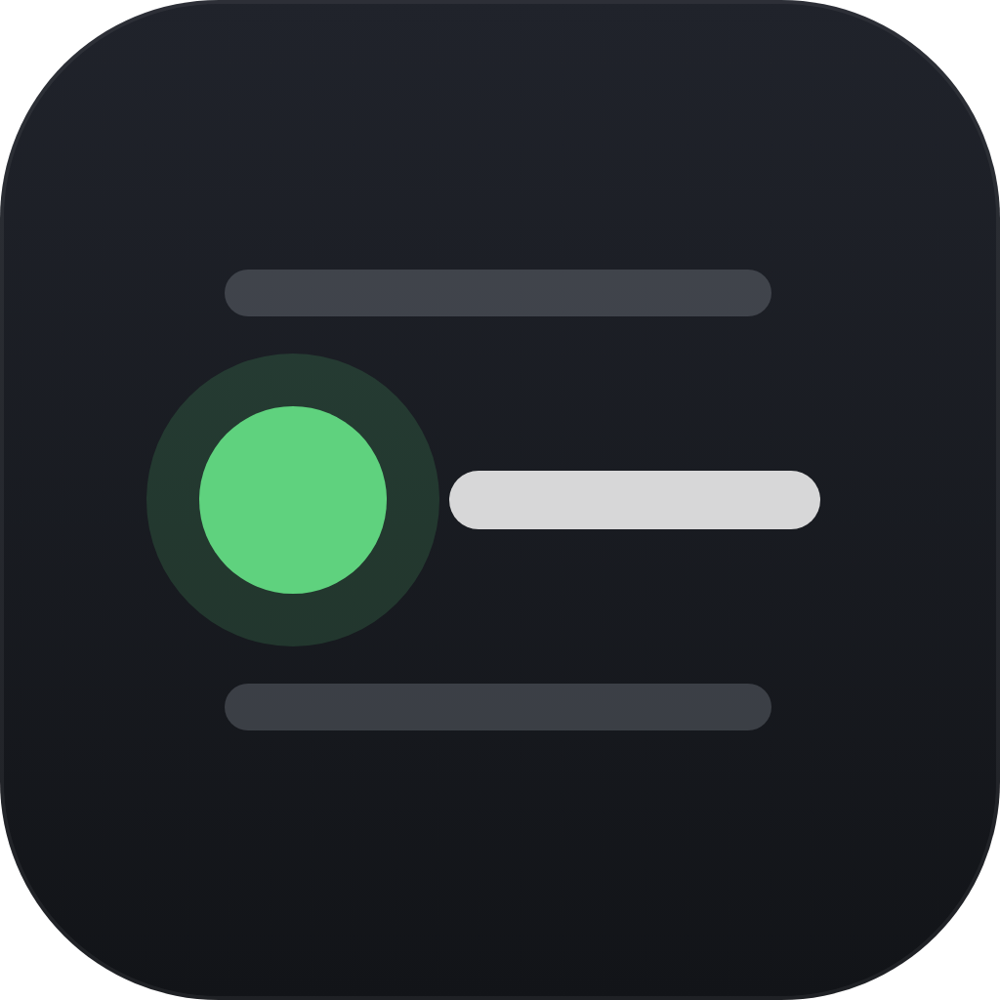
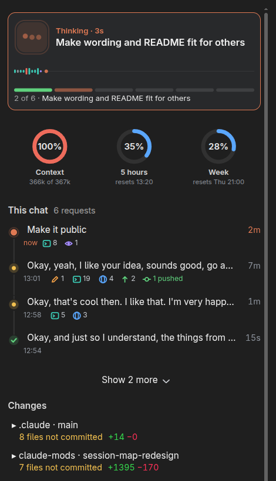

# claude-mods

Three mods for Claude Code: small plugins that change Claude's own interface.
They are built for the desktop app's Code tab and work in the terminal where
noted.

| Mod | What it adds |
| --- | --- |
|  [**session-map**](session-map/README.md) | A side pane that shows what Claude is doing, what each request came to, and where your changes stand in git |
|  [**working-dot**](working-dot/README.md) | A green dot on a chat's sidebar title while Claude works in it |
|  [**plan-meter**](plan-meter/README.md) | Context and plan limits in one line above the prompt |

## Install

In Claude Code, add this repository as a marketplace, then install the mods
you want:

```text
/plugin marketplace add tristanmuzzu/claude-mods
/plugin install session-map@tristan-mods
/plugin install working-dot@tristan-mods
/plugin install plan-meter@tristan-mods
```

Or from a shell:

```bash
claude plugin marketplace add tristanmuzzu/claude-mods
claude plugin install session-map@tristan-mods --scope user
```

Restart the app (or start a new session) to load them. Updates arrive with
`claude plugin marketplace update tristan-mods`. They need a Claude Code
build that runs mods (tested on 2.1.319).

## The mods

Each mod's own README says what it shows and everything it reads, writes and
runs:

- [session-map](session-map/README.md)
- [working-dot](working-dot/README.md)
- [plan-meter](plan-meter/README.md)



## Developing

```bash
git clone https://github.com/tristanmuzzu/claude-mods
claude plugin marketplace add ./claude-mods
claude plugin test session-map
```

`claude plugin test <mod>` runs a mod's tests from the repository root;
`claude plugin validate <mod>` checks it the way the engine loads it.

## License

MIT
