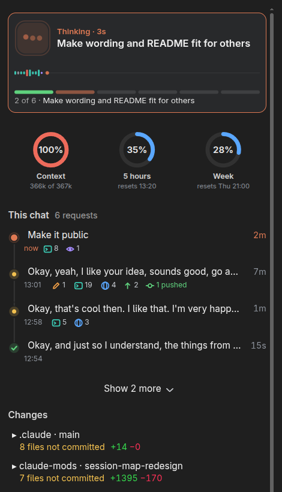

# session-map

A side pane that shows what is going on in one chat at a glance, read by
shape and colour rather than text.



Top to bottom:

- **Now**: an animated icon acts out what Claude is doing (an eye while it
  reads, a pencil while it edits, a terminal while a command runs, a globe for
  web and screen work, orbiting dots for helpers, bouncing dots while it
  thinks), with the step in one line and how long it has taken. Under it a
  heartbeat: one bar per step of the request, in the colour of its kind of
  work and as tall as it took (red when it failed), the step running now
  breathing at the right end. Then the chat's task list as a track with the
  step in progress, and what else is running: background commands, helpers,
  monitors, workflows and wake-ups, each with its time. When Claude waits on
  you it says so ("Needs your answer", "Your call"); when a turn ends with work
  still running in the background it says what it waits on; when a request
  finishes, the first line of its own recap is the headline.
- **Vitals**: rings for context before auto-compaction, the 5-hour limit and
  the weekly limit, with reset times.
- **This chat**: the last four requests as a timeline (Show more opens the rest below, same size): a node per request (breathing
  while it runs, a tick when done, amber when it left you a question), one
  line of what you asked, how long Claude worked on it, and icons with counts
  for edits, commands, lookups, web steps, helpers and commits (pushed or
  not). Press a request to open it: what you asked in full, its heartbeat,
  what it did and how long it took, its recap and question, the files it
  changed (each opens its diff), the commits it made and its links.
  Background-task and app messages fold into the request they belong to.
  A pull request link says where it stands: checks running, passing or
  failing, merged or closed.
- **Changes**: one line per project with where it stands in git ("3 files
  not committed", "2 commits, all pushed"). Press it to list every changed
  file Claude edited, plus files commands changed or created with real lines
  (eight at a time, Show more for the rest). Press a file for its diff, with
  the lines' real numbers, or ✎ to
  open it in your code editor: the first of VS Code, Cursor, Zed, Codium,
  Sublime Text or GNOME Text Editor that is installed.

- **Other chats**: the other chats that are doing something, the ones that
  need you first (needs you, working, waiting on background work), and the
  ones that finished since you last looked at them. Once you open a finished
  chat it leaves the board. Each row has a mark for where the chat stands,
  its title, how long ago it moved, a small heartbeat of its current request
  and one line on what it is doing or asking. Four show at once, with Show
  more for the rest. Press a title to go to that chat. Desktop app only.

## What it reads, writes and runs

Everything stays on your computer except one GitHub request, listed below.

- **Reads**
  - The chat's own tool calls as they happen, including the desktop app's
    task list and wrap-up.
  - When it loads after a chat has begun, that chat's own transcript (one
    `.jsonl` file under `~/.claude/projects/`), to catch up on the steps it
    missed.
  - Files Claude edits, to find an edit's line number.
  - The app's list of chats (titles and links, through its `list_sessions`
    tool) and other chats' notes, for the Other chats board.
  - Two times from the desktop app's own record of each listed chat (when you
    last opened or wrote in it, and when its last turn ended), to tell which
    finished chats you have not opened yet. These records live under
    `~/.config/Claude/claude-code-sessions/`; the map only reads them.
- **Runs**
  - Read-only git commands (`status`, `diff`, `log`, `rev-parse`,
    `rev-list`) in projects the chat touches.
  - `grep` to count lines in new files.
  - `jq` to read the transcript, when it is installed.
- **Network:** `gh pr view` for pull requests the chat opened, once a minute
  while one is open and recent or its checks run. This uses your own `gh`
  login, and nothing else leaves your computer.
- **Writes:** one small file per chat,
  `~/.local/state/claude-session-map/chats/<chat id>.json`, holding where that
  chat stands (its state, current step, one line of status and step timings),
  so other chats' maps can show it.
- **Starts**
  - Your code editor, when you press ✎.
  - `xdg-open` (or `open` on macOS) with the chat's own `claude://` link, when
    you press a chat on the board.
- **Never** makes model calls.

`/map` opens the pane again if you close it.

## Install

In Claude Code:

```text
/plugin marketplace add tristanmuzzu/claude-mods
/plugin install session-map@tristan-mods
```

Then restart the app or start a new session. It needs a Claude Code build
that runs mods (tested on 2.1.319). Source, tests and the other mods:
[github.com/tristanmuzzu/claude-mods](https://github.com/tristanmuzzu/claude-mods).

## License

MIT
